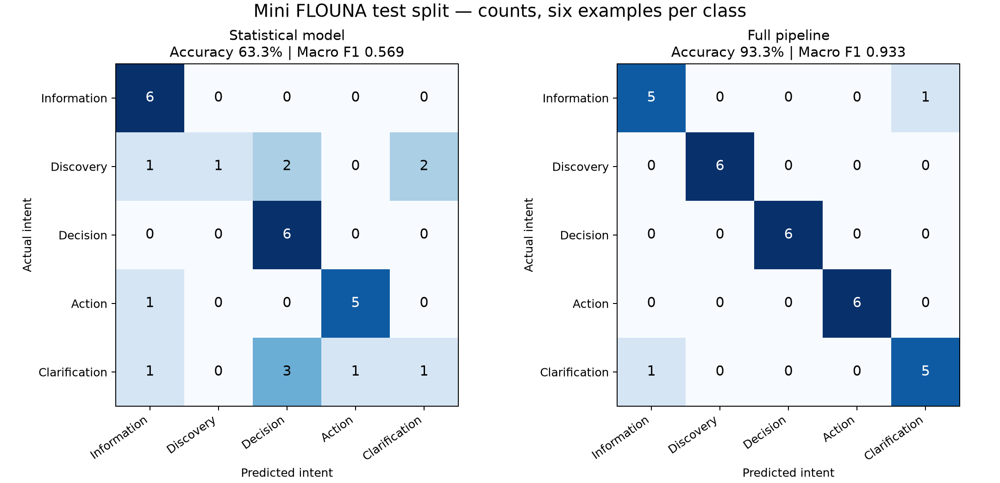

# Evaluation results

The frozen 30-request test split was evaluated after model selection and validation-driven policy changes were complete. Runtime rules, model parameters, gold labels, and split assignments were not changed in response to test errors.

A later readability cleanup replaced the generic constraint loops with direct dish, cuisine, location, budget, and delivery checks. Complete responses for all 150 labelled requests and eight saved examples were compared against the preceding committed code and were identical. Re-running evaluation also preserved every reported metric and failure. The report hashes retain the original evaluation provenance.

## Final test results

| Component | Test accuracy | Macro F1 | False Actions among 24 non-Action requests |
| --- | ---: | ---: | ---: |
| Raw statistical model | 63.3% (19/30) | 0.569 | 1/24 |
| Model with explicit intent checks | 83.3% (25/30) | 0.816 | 0/24 |
| Full routing pipeline | 93.3% (28/30) | 0.933 | 0/24 |



`test_metrics.json` includes per-class precision, recall, F1, confusion matrices, false Action counts/rates, extraction metrics, and errors. `test_predictions.jsonl` records every test input and its raw, guarded, and final prediction. The report also records model/data/split hashes, a runtime source hash, the runtime source commit, and dependency versions. These traces make the evaluation auditable; model binaries remain local.

The final pipeline misclassifies two requests:

- “I would like a definition of biryani.” is Information but gets Clarification.
- “The other one would be fine.” requires Clarification but gets Information.

Both remain documented failures. The second is a limitation in missing-context detection; it does not produce a food recommendation or execute an action.

## Preference extraction results

Only 12 of the test requests have gold preference annotations. Standalone extraction and pipeline extraction both achieve 11/12 exact request matches (91.7%). Across 11 fields per request, 131/132 field values match (99.2%); explicitly present values match 35/36 (97.2%), and missing values match 96/96. An always-empty preference object would match 72.7% of these field values, which is why overall field accuracy alone would be misleading.

The error is “Find not spicy noodles.” The extractor correctly retains an unsupported spice requirement but also emits an extra exclusion category. The system still blocks a recommendation because spice information is unavailable; the extra category is counted as an extraction error.

Unsupported constraints are compared as category sets, ignoring explanatory text after a colon. Other text is compared ignoring case and surrounding/repeated whitespace; numeric bounds and operators must match exactly. Per-field present/missing denominators, exact-request accuracy, and all mismatches are included in the JSON report. These are small-sample synthetic results, not production estimates.

## Reproduce final evaluation

```bash
python -m scripts.prepare_splits
python -m scripts.train
python -m scripts.evaluate
python -m pytest -q
```

Evaluation never fits the model or selects thresholds. It refuses dataset/split hash mismatches against the model's training metadata. An optional `--split validation` supports diagnostic reporting without changing the saved model. Use `--output-dir` for alternate report destinations.

## Validation results

`validation.json` records model selection on the frozen 90-request training and 30-request validation splits. It includes data hashes, dependency versions, all nine candidate configurations, raw-model metrics, guarded-intent metrics, final-pipeline metrics, per-class precision/recall/F1, confusion matrices (rows are actual, columns predicted, using `class_order`), and final-pipeline validation errors.

## Reproduce

```bash
python -m scripts.prepare_splits
python -m scripts.train
```

The selected configuration is word TF-IDF unigrams/bigrams with sublinear term frequency and Logistic Regression C=4, seed 42, and a 0.25 clarification threshold. The feature vocabulary is fitted on training text only. The selected model remains fitted on 90 requests; validation data is not added to its fitting set. Train using the recorded library versions for the closest numerical reproduction.

| Component | Validation accuracy | Macro F1 | False Actions |
| --- | ---: | ---: | ---: |
| Raw statistical model | 80.0% | 0.802 | 0 |
| Model with explicit intent checks | 86.7% | 0.856 | 0 |
| Full routing pipeline | 96.7% (29/30) | 0.966 | 0 |

There are 24 actual non-Action requests in validation; the false Action rate is 0/24 for these results. Zero observed errors on such a small sample does not establish a zero real-world error rate.

## What validation changed

The initial Action-gated classifier confused some explicit list requests with decisions and a speed-oriented choice request with information. Small list/choice checks were added. Pipeline checks also prevent known missing mandatory dietary details from being ignored, allow explicit unresolved locality constraints to trigger clarification even after an Information prediction, and avoid interpreting known ambiguous units or foreign currency as INR budgets.

These are documented policy choices refined using validation examples. Candidate selection uses the final pipeline's validation predictions. This report is therefore a tuning result, not an independent final performance estimate. Unit regression tests exercise these policies separately from the frozen test set.

## Remaining error and limits

“Which ordering actions can the prototype perform?” is labelled Information but the final pipeline asks for clarification. This failure remains recorded rather than changing the gold label or adding a phrase-specific exception.

The dataset is small, synthetic, balanced, and AI-authored. Six validation examples per class come from only two paraphrase groups. Checks are conservative and bounded: complex mixed intents, negation, indirect action requests, and new wording can still fail. The Information route is a catalogue/prototype FAQ, not a general knowledge model. Numeric probabilities are not calibrated.

The historical `validation.json` retains `test_evaluated: false` because its training run did not compute test predictions. Final test evaluation is recorded separately in `test_metrics.json` with `test_evaluated: true`. Validation and test scores must not be combined or presented as the same result.
